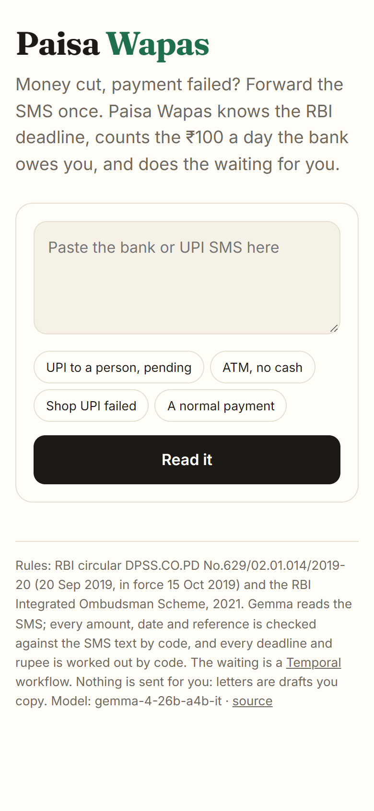
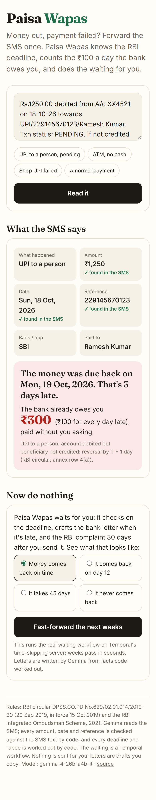
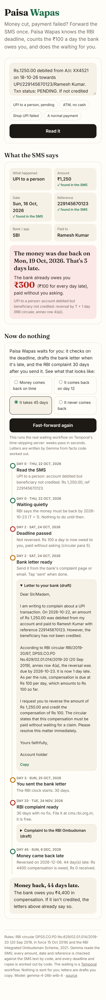

# Paisa Wapas

**Money cut, payment failed? Forward the SMS once. Paisa Wapas knows the RBI deadline, counts the ₹100 a day the bank owes you, and does the waiting for you.**

**Live:** https://paisa-wapas-1037019152152.asia-south1.run.app (no sign-up)

Built for the DEV *Hacktoberfest Open-Source AI Challenge*, Week 3: *Slow and Steady*.

| Read the SMS | The deadline and what's owed | Fast-forward 45 days |
|---|---|---|
|  |  |  |

## The rule almost nobody uses

Since 15 Oct 2019, RBI's circular on failed transactions (DPSS.CO.PD No.629/02.01.014/2019-20) sets a deadline for every kind of failed payment: a UPI transfer that left your account but never reached the other person must be reversed by **T + 1**, an ATM that didn't give cash by **T + 5**, and so on. After that the bank owes you **₹100 for every day of delay**, and paragraph 5 says it must credit that **without waiting for a complaint**. If the bank doesn't fix it, the RBI Integrated Ombudsman Scheme, 2021 lets you complain to RBI for free, 30 days after a written complaint to the bank.

Nobody tracks this. It means remembering a date, checking the account, writing a letter, waiting a month, writing another one. Paisa Wapas does the remembering, the counting, the waiting and the drafting; you forward one SMS.

## How it works

1. **Gemma reads the SMS** (`app/reader.py`): what happened (UPI to a person or a shop, ATM, card, IMPS, AePS, wallet, a reversal, or nothing to chase), the amount, the date, the reference, the bank and the payee.
2. **Code checks everything Gemma says against the SMS.** An amount, date or reference that isn't in the text is dropped and listed. The model never decides a deadline or a rupee.
3. **Code applies the circular** (`app/rules.py`): the annex row, T + 1 or T + 5, days late, ₹100 a day.
4. **A Temporal workflow waits** (`app/workflow.py`): a durable timer to the deadline; if no reversal arrives, Gemma drafts the bank letter from facts code worked out (and the letter is replaced by a plain one if Gemma drops or changes a number); you tap "sent"; 30 days later, the RBI complaint. When the money comes back, it works out the compensation owed. A laptop restart doesn't lose any of it.
5. **Nothing is sent for you.** Letters are drafts you copy.

The live demo runs the real workflow on Temporal's **time-skipping test server**: pick "it takes 45 days" and watch 45 days of patient waiting in about 15 seconds, as if the SMS arrived today. On your own machine, point it at a real Temporal server and it waits the real days.

## Reading SMS: Gemma vs a keyword baseline

40 SMS in the formats of SBI, HDFC, ICICI, Axis, Kotak, PNB, Canara, Bank of Baroda, Paytm and PhonePe, written by hand (no real customer data), including Hinglish ones, a balance printed before the amount, a reversal mentioned inside a success message, and normal payments that must not be chased. The baseline is the regex app I'd otherwise write. Run it with `python scripts/eval.py`.

| | Letter-ready (deadline, amount and date right) | Wrong chase / don't-chase call | Amount right | Held-out 31-40: letter-ready | Time per SMS |
|---|---|---|---|---|---|
| Regex baseline (written while looking at SMS 1-30) | 20/25 | 3/40 | 23/25 | 4/8 | instant |
| Gemma 4 26B A4B, thinking on | 24/25 | 1/40 | 25/25 | 7/8 | 23.9 s |
| **Gemma 4 26B A4B, thinking minimal (default)** | 23/25 | 1/40 | 25/25 | 7/8 | 3.3 s |

## Run it

```bash
python -m venv .venv && .venv/Scripts/pip install -r requirements.txt pytest pytest-asyncio
set GEMINI_API_KEY=...                          # Gemma 4 through Google AI Studio
.venv/Scripts/python -m uvicorn server:app --app-dir app --port 8792
.venv/Scripts/python -m pytest tests            # the workflow, including a 36-day case, on the time-skipping server

# real waiting instead of the preview
temporal server start-dev
set PAISA_TEMPORAL=localhost:7233
.venv/Scripts/python app/worker.py
```

`PAISA_MODEL` picks the Gemma model (default `gemma-4-26b-a4b-it`), `PAISA_THINKING` its thinking level (default `minimal`).

## Sources

- RBI, *Harmonisation of Turn Around Time (TAT) and customer compensation for failed transactions using authorised Payment Systems*, RBI/2019-20/67, 20 Sep 2019 (text in `data/rbi-tat-2019.txt`).
- RBI Integrated Ombudsman Scheme, 2021: complain to the bank in writing first; go to RBI (cms.rbi.org.in) if there's no reply in 30 days, within one year and 30 days.

This is not legal or financial advice; it reads the published rules and drafts letters you can check and send yourself.

## License

MIT
